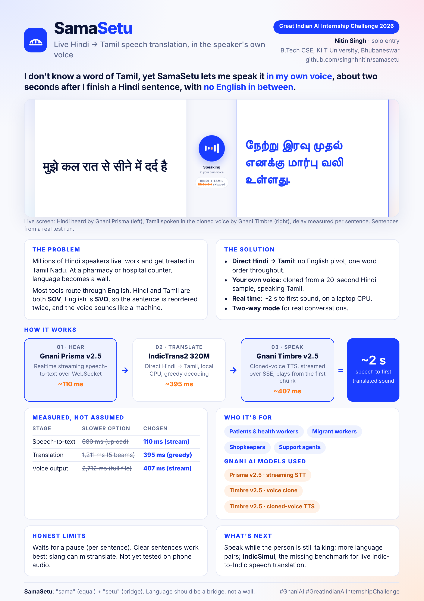

# SamaSetu · One-Page Solution Pitch

**Great Indian AI Internship Challenge 2026 · Nitin Singh (solo) · KIIT University, Bhubaneswar**

📄 Printable version: [docs/SamaSetu_Pitch.pdf](docs/SamaSetu_Pitch.pdf)

---

**I don't know a word of Tamil, yet SamaSetu lets me speak it in my own voice, about two seconds after I finish a Hindi sentence, with no English in between.**

### The problem
Millions of Hindi speakers live, work and get treated in Tamil Nadu. At a pharmacy or hospital counter, language becomes a wall. Most tools route Indian languages through English. Hindi and Tamil are both **SOV**, English is **SVO**, so the sentence is reordered twice, and the translated voice sounds like a machine.

### The solution
- **Direct Hindi → Tamil:** no English pivot, one word order throughout.
- **Your own voice:** cloned from a 20-second Hindi sample, speaking Tamil.
- **Real time:** ~2 s to first sound, on a laptop CPU. No GPU.
- **Two-way mode** for real conversations.

### How it works
| Stage | Model | Time |
| --- | --- | --- |
| Hear | **Gnani Prisma v2.5**, realtime streaming speech-to-text over WebSocket | ~110 ms |
| Translate | **AI4Bharat IndicTrans2** (320M), direct Hindi → Tamil, local CPU | ~395 ms |
| Speak | **Gnani Timbre v2.5**, cloned-voice TTS streamed over SSE | ~407 ms to first chunk |
| **End to end** | | **~2 s** speech to first translated sound |

### Measured, not assumed
| Stage | Slower option | Chosen |
| --- | --- | --- |
| Speech-to-text | 680 ms (upload) | **110 ms (stream)** |
| Translation | 1,211 ms (5 beams) | **395 ms (greedy)** |
| Voice output | 2,712 ms (full file) | **407 ms (stream)** |

### Who it's for
Patients and health workers · migrant workers · shopkeepers · support agents

### Gnani AI models used
Prisma v2.5 (streaming STT) · Timbre v2.5 (voice clone) · Timbre v2.5 (cloned-voice TTS)

### Honest limits
Waits for a pause (per sentence). Clear sentences work best; slang can mistranslate. Not yet tested on phone audio.

### What's next
Speak before the sentence ends · more Indian language pairs · **IndicSimul**, a public benchmark for real-time Indic-to-Indic speech translation, which doesn't exist today.

---
*SamaSetu: "sama" (equal) + "setu" (bridge). Language should be a bridge, not a wall.*
`#GnaniAI` `#GreatIndianAIInternshipChallenge`
