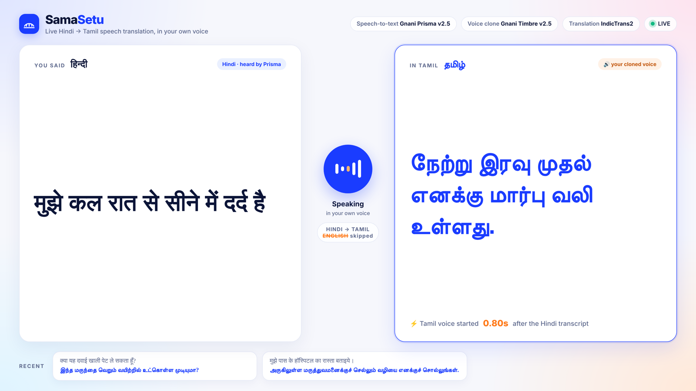
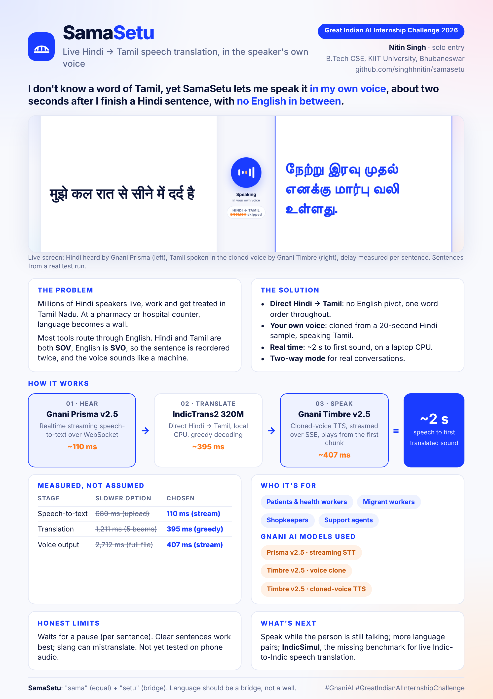

<p align="center">
  
</p>

<h1 align="center">SamaSetu</h1>

<p align="center"><b>I don't know a word of Tamil. SamaSetu lets me speak it, in my own voice.</b><br>
Live Hindi → Tamil speech translation · no English in between · ~2 s on a laptop CPU</p>

<p align="center">
  
  
  
  
</p>

<p align="center">
  📄 <a href="PITCH.md"><b>One-page solution pitch</b></a> · <a href="docs/SamaSetu_Pitch.pdf">PDF</a>
</p>

Built solo for the **Great Indian AI Internship Challenge 2026** by Gnani AI.
`#GnaniAI` `#GreatIndianAIInternshipChallenge`

---

## One-page solution pitch

<p align="center"><a href="docs/SamaSetu_Pitch.pdf"></a></p>
<p align="center"><i>Click the image for the PDF, or read it as text in <a href="PITCH.md">PITCH.md</a>.</i></p>

---

## The problem

India has 22 scheduled languages, but most speech translation between two Indian languages goes through English. Hindi and Tamil are both **SOV** (subject-object-verb). English is **SVO**. So the English pivot reorders the sentence once going in and again coming out. That costs time, it loses meaning, and it doesn't work for live speech, where you want to start talking before the sentence ends.

There's also a voice problem. A translated voice that doesn't sound like the speaker feels like a machine talking, not a person.

SamaSetu translates **Hindi → Tamil directly** and plays the result **in the speaker's own voice**.

**Who it's for:** a Hindi-speaking patient talking to a Tamil-speaking nurse, a migrant worker talking to a local shopkeeper, a call-centre agent handling a caller from another state.

---

## Gnani AI models used

| Gnani model / API | What it does in SamaSetu |
| --- | --- |
| **Prisma v2.5** (realtime speech-to-text, WebSocket `stt/v3/stream`) | Streams Hindi speech from the mic, with voice-activity detection to cut sentences |
| **Timbre v2.5 — voice cloning** (`tts/voice-clone/embeddings`) | Builds a speaker embedding from one short Hindi recording |
| **Timbre v2.5 — cloned-voice TTS** (`vachana-vc-v1`, SSE streaming) | Speaks the Tamil translation in the cloned voice, chunk by chunk |

The only non-Gnani component is the translation model: **AI4Bharat IndicTrans2** (`indictrans2-indic-indic-dist-320M`, open source). It runs locally and translates Indic→Indic with no English step.

---

## How it works

```
 mic (16 kHz)
   │
   ▼
 Gnani Prisma v2.5 ── realtime WebSocket, VAD cuts each sentence
   │  Hindi text
   ▼
 IndicTrans2 320M ── hin_Deva → tam_Taml, greedy decoding, local CPU
   │  Tamil text
   ▼
 Gnani Timbre voice clone ── SSE stream, your speaker embedding
   │  audio chunks
   ▼
 speaker ── playback starts at the first chunk
```

Each finished sentence goes to its own worker thread. The mic keeps listening while the previous sentence is being translated and spoken.

---

## Measured latency

All numbers are measured on a laptop CPU (Windows 11, Python 3.10), no GPU.

| Stage | Setting used | Measured | Slower alternative I tested |
| --- | --- | --- | --- |
| Speech-to-text | Prisma realtime WebSocket | ~110 ms per segment | ~680 ms via REST upload |
| Translation | IndicTrans2, 1 beam | ~395 ms | ~1,211 ms with 5 beams |
| Speech out | Timbre SSE, first chunk | ~407 ms to first audio | ~2,712 ms waiting for the full file |
| **End to end** | | **~2 s to first sound** (2.1 s in the recorded demo) | |

Switching speech output from waiting for the full file to streaming SSE chunks cut the wait for the voice from ~2.7 s to ~0.4 s. The scripts used to measure these are `latency.py`, `tts_stream.py` and `speed.py`.

---

## Running it

```powershell
git clone https://github.com/singhhnitin/samasetu.git
cd samasetu
python -m venv mtenv
.\mtenv\Scripts\Activate.ps1
pip install -r requirements.txt
huggingface-cli login          # IndicTrans2 is gated; request access on Hugging Face first
$env:GNANI_API_KEY="your-key"
```

1. Record about 20 seconds of yourself speaking clearly and save it as `ref.mp3`.
2. Run `python embed.py` once. It writes `embedding.json`, your voice embedding.
3. Run `python samasetu.py` and speak Hindi.
4. **Live screen:** in a second terminal run `python -m http.server 8000`, then open **http://localhost:8000/display.html** and press F11. It shows the Hindi, the Tamil, and how fast the Tamil voice started for every sentence.

**Two-way conversation** (run one process per speaker):

```powershell
python twoway.py hi    # Hindi speaker → Tamil
python twoway.py ta    # Tamil speaker → Hindi
```

**Batch run** over a folder of clips: put `.wav` files in `clips/` and run `python batch.py`. It writes `results.csv`.

Your voice recording and `embedding.json` are in `.gitignore`. They never go into the repo.

---

## Files

| File | Purpose |
| --- | --- |
| `samasetu.py` | Main live pipeline: mic → Prisma → IndicTrans2 → Timbre → speaker, auto-reconnects, writes `display.json` |
| `display.html` | Live screen: Hindi, Tamil, per-sentence latency, recent sentences |
| `docs/SamaSetu_Pitch.pdf` | One-page solution pitch |
| `twoway.py` | Two-way mode, Hindi ↔ Tamil |
| `embed.py` | Builds the voice-clone embedding from `ref.mp3` |
| `batch.py` | Runs the pipeline over `clips/`, writes `results.csv` |
| `pipeline.py` | Single-clip end-to-end test |
| `latency.py`, `tts_stream.py`, `speed.py` | Latency measurements for each stage |
| `transcribe.py`, `translate.py`, `try_both.py`, `chain.py` | Stage-by-stage experiments from development |

---

## Limitations (honest list)

- **One language pair is tested properly.** Hindi → Tamil is what I tested and measured. Tamil → Hindi works in `twoway.py` but I haven't measured it as carefully.
- **Sentence-level, not word-level.** It waits for a pause before translating, so a long sentence means a longer wait. True simultaneous translation, speaking while the person is still talking, is the next step.
- **Voice similarity is judged by ear.** Cross-lingual cloning works (Hindi enrolment, Tamil output), but I haven't measured it with a speaker-verification model yet.
- **No formal translation-quality score yet.** I've checked outputs by hand. A BLEU/chrF evaluation is planned.
- **Quiet room assumed.** I haven't tested it on noisy or phone-quality audio.
- **Script handling.** IndicTrans2's Indic-Indic model outputs Devanagari, so Tamil is converted to Tamil script with `indic-nlp-library`.

---

## What's next

There's no public benchmark for **live Indic-to-Indic speech translation**. VAKTA-SETU, the closest prior system I found, works offline on one language pair and reports no latency numbers. The next step for SamaSetu is a small benchmark, *IndicSimul*: 150 utterances, comparing direct translation against translation through English, measured for both latency and quality.

---

## Credits

- **Gnani AI** for Prisma, Timbre and voice cloning
- **AI4Bharat** for IndicTrans2 and the Indic NLP Library

Built by **Nitin Singh**, B.Tech CSE, KIIT University, Bhubaneswar.
